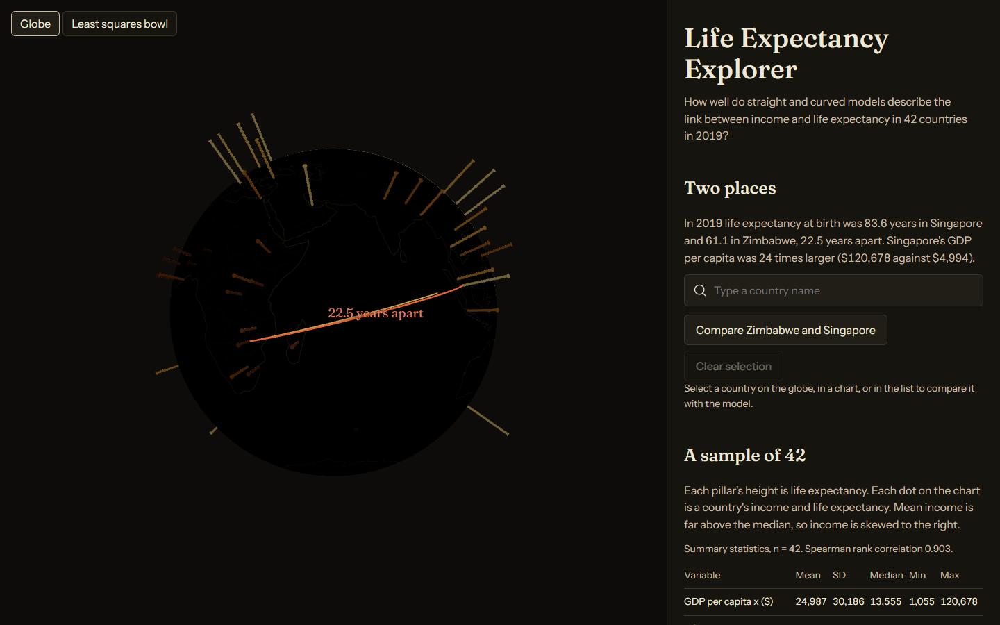

# Life Expectancy Explorer

An interactive companion to a Mathematics AA SL Internal Assessment. It asks how well a straight line and a logarithmic curve describe the link between income and life expectancy across 42 countries in 2019.

The app is built around the student's own 42 rows, not a demonstration dataset. Every number in the interface is recomputed in the browser from `data/sample42.csv` and checked against the values printed in the written IA.



## What it does

- **Globe stage.** Forty two pillars rise from capital city coordinates. Height is life expectancy and colour is the same value on a single ramp. Singapore and Zimbabwe are joined by an arc labelled 22.5 years, the observed gap.
- **Country selection.** Click a pillar, search by name, or use the country list in the panel. Selecting a country flies the camera to it and updates every view.
- **Two models.** A straight line and a logarithmic curve can be shown on a linear or logarithmic income axis. The panel reports the equation, r, r squared, the residual standard error and the sum of squared errors for both.
- **Seven SVG charts.** Scatter with both fits, residuals for each model, the gap, the derivative, the inverse and box plots by income group, plus the least squares bowl in 3D and the sensitivity table.
- **Show working.** A drawer lists each calculation with its formula, inputs and result.
- **Sensitivity.** Excluding Nigeria and Chad refits everything and shows how much of the gap survives.
- **The 3D bowl.** Sum of squared errors drawn as a surface over slope and level, with sliders to move away from the least squares minimum.

## The Internal Assessment it serves

| Item | Value |
|---|---|
| Year | 2019 |
| Countries | 42 |
| GDP indicator | `NY.GDP.PCAP.PP.KD`, constant 2021 international dollars at PPP |
| Life expectancy indicator | `SP.DYN.LE00.IN`, years at birth |
| Singapore | 83.6 years, $120,678 |
| Zimbabwe | 61.1 years, $4,994 |
| Observed gap | 22.5 years |

### Results the app reproduces

| Quantity | Straight line | Logarithmic |
|---|---|---|
| Equation | y = 0.000220x + 66.14 | y = 5.928 ln x + 16.02 |
| r | 0.745 | 0.877 |
| r squared | 0.555 | 0.769 |
| Residual standard error | 6.03 years | 4.35 years |
| Sum of squared errors | 1,454.1 | 755.7 |

The logarithmic model predicts 85.38 years for Singapore and 66.50 for Zimbabwe, a gap of 18.88 years, which is 83.8 percent of the observed gap. Reading the model in reverse, Singapore's life expectancy corresponds to about $89,300 at the fitted curve. Excluding Nigeria and Chad raises r to 0.925 and leaves 79.3 percent of the gap.

## Data integrity

`data/sample42.csv` holds the 42 rows printed in the IA's Appendix A, with coordinates, region, income group, indicator codes and a provenance note on every row. `scripts/fetch_worldbank.mjs` pulls the same two indicators for the same 42 countries from the World Bank API and writes `data/worldbank_2019_pull.csv`. The pull currently matches Appendix A to 0.00 percent on GDP and 0.000 years on life expectancy. The appendix values stay authoritative, and the pull is a check rather than a replacement.

`scripts/anchor_check.mjs` re-derives the four values the IA prints and the two model predictions from the CSV. All 11 anchors pass.

## Running it

```bash
npm install
npm run dev        # local development
npm run build      # type check and production build
npm run preview    # serve the built app
npm test           # 39 tests
npm run data:fetch # live World Bank pull and comparison
npm run data:anchor
```

The app is a static site. The built output in `dist/` can be hosted anywhere.

## Accessibility and performance

- One h1, no skipped heading levels, every SVG chart has a `role="img"` and an accessible name, and the whole 42 country table is available to screen readers.
- Text contrast ranges from 6.57:1 to 15.23:1 on the panel background, above WCAG AA.
- No horizontal overflow at 375, 414, 768 or 1440 pixels.
- Reduced motion is respected in CSS and in the Three.js camera and rotation code.
- The 3D stage is lazy loaded, so the charts and the text arrive before WebGL.
- Measured bundle: about 45 kB of app code, 48 kB of d3 code, 300 kB of React Three Fiber and 667 kB of Three.js before gzip.

The full audit is in `docs/audit.json`, and the test transcript is in `docs/TEST_RUN.txt`.

## Project layout

```
data/            sample42.csv, the live pull, provenance
docs/            decisions, research, maths notes, audits, screenshots
scripts/         World Bank pull, anchor check, cross check, screenshots, audit
src/charts/      nine SVG charts
src/data/        CSV loading and schema
src/geo/         projection and globe texture
src/math/        regression, gap, bowl, statistics, contract tests
src/three/       globe, pillars, arc, camera, bowl, preview
src/ui/          controls, tables, working panel, tools
```

## Limits

- The data are observational and aggregated. The model describes an association, not a cause.
- A straight line on the dollar scale is dominated by the high income countries. The logarithmic fit is better but still leaves Nigeria and Chad far below the curve.
- The inverse uses the fitted curve, so it inherits the model's error. It is an illustration, not a policy target.
- The 42 country sample is not the world. It is the set chosen in the IA.

## Credits

Data: World Bank, World Development Indicators, 2019. Country outlines: Natural Earth, through `world-atlas`. Typefaces: Fraunces and Instrument Sans, through Fontsource. Built with React, Vite, Three.js and React Three Fiber.
